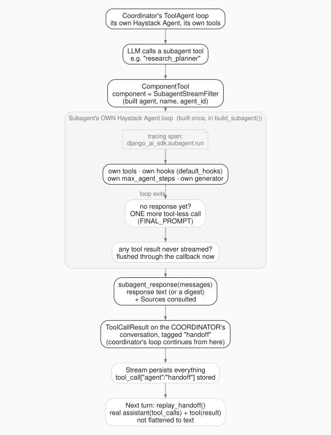

The `Agent` class: what it configures and which hooks the SDK calls.

:::note
To build an app, see the [Agents guide](../agents/agents.md). This page is the internal reference.
:::

## Responsibilities

The `Agent` is the coordinator. It:

- Declares the model setup: `name`, `model`, `instructions`
- Picks a protocol handler and a storage adapter
- Provides the adapter hooks that build `Stream` and `Run`
- Has lifecycle hooks for RAG warmup, citations and suggestions

## Configuration

The main class attributes are below. The [Agents guide](../agents/agents.md) has the full table.

| Variable | Default | Purpose |
| --- | --- | --- |
| `name` | None | Display name |
| `model` | `None` | Model identifier passed to the generator |
| `llm` | `openai_responses_chat` | Generator factory, assigned uncalled |
| `llm_kwargs` | `None` | Vendor generation parameters for that factory |
| `instructions` | built-in prompt | System prompt, built with `prompt()` |
| `protocol` | `VercelProtocolHandler` | Wire-format handler class |
| `storage_adapter` | `MemoryStorageAdapter` | Fallback storage class |
| `tools` | `[]` | Class-level tool providers |
| `integrations` | `[]` | Integration names whose tools reach this agent |
| `artifacts` | `[]` | `ArtifactSchema` subclasses exposed as submission tools |
| `rag_provider` | `None` | `RAGProvider` instance for RAG |
| `memories` | `[]` | Default connected memories |
| `max_history` | `None` | Cap on messages sent to the model |
| `response_format` | `None` | Pydantic model for structured `run()` output |
| `title_generation` | `True` | Auto-generate thread titles |
| `oversight` | `None` | Oversight policy: a `Policy` subclass, a name, `None` (`DEFAULT_POLICY`) or `False`; see [Oversight](oversight.md#agents-and-runs) |
| `permissions` | `None` | Permission classes gating operations; `None` or `[]` uses the `agent` domain default |
| `warmup_on_init` | `False` | Warm up RAG on instantiation |
| `hidden` / `abstract` | `False` | Registry behavior flags |

`Agent.__init__` instantiates `self.protocol()` into `self.protocol_handler`.

## Adapter hooks

The SDK calls two adapter hooks. By default, `get_pipeline_adapter` returns a `Stream` over a `ToolAgent` built from the agent's generator, tools and prompt. `get_run_adapter` returns `Run(generator=self.get_llm())` by default and must return a `Run`.

| Hook | Returns | Used by |
| --- | --- | --- |
| `get_pipeline_adapter(thread_id, user)` | `Stream` | `Agent.as_view()` (streaming chat) |
| `get_run_adapter(thread_id, user)` | `Run` | `Agent.run()` (titles, extraction, jobs) |

```python
async def get_pipeline_adapter(self, thread_id=None, user=None):
    generator = self.get_llm()
    tool_agent = ToolAgent(
        config=ToolAgentConfig(
            model=self.get_model(),
            system_prompt=self.get_system_prompt(),
            tools=await self.get_tools(thread_id=thread_id or "", user=user),
        ),
        generator=generator,
    )
    return Stream(
        pipeline=tool_agent.pipeline(),
        generator=generator,
        storage_adapter=await self.get_storage_adapter(thread_id),
    )
```

The default `get_pipeline_adapter()` is this Stream over a `ToolAgent` with `get_llm()`, the agent's tools and its limits. Override it for another pipeline.

## Storage resolution

`get_storage_adapter(thread_id)` asks every registered adapter for the thread and returns a bound instance. If no adapter has the thread, it uses the agent's `storage_adapter`. See [Storage](storage.md).

## Tool assembly

`get_tools(thread_id, user)` combines, in order:

1. Class-level `tools` providers, each called with `thread_id` and `user` keyword arguments
2. Integration tools from the `integrations` list
3. Artifact submission tools from `artifacts`
4. Subagent tools from the `agents` list, one `ComponentTool` per subagent

`get_rag_tools(thread_id, user)` appends one retrieval tool per active memory when `rag_provider` is set. See [RAG](rag.md).

## Subagent delegation



`agents = [SubagentA, SubagentB]` on an `Agent` turns each subagent into a Haystack `ComponentTool` the coordinator can delegate to. Only plain `Agent` subclasses can appear in that list. A `RuntimeAgent`, configured in the database, cannot: its `__init__` requires an `AgentSettings` row, and `agents = [...]` holds bare classes with no way to pass one in. `hidden = True` on a subagent is a convention, and the SDK does not enforce it.

- `get_agent_tools(thread_id, user)` builds them, per class in `self.agents`:
  1. **Cycle guard, declaration-level.** Skip `subagent_cls is self.__class__` (no self-delegation) and any class path already seen this call.
  2. **Permission check.** `AgentService.has_perms(user, Operation.VIEW_AGENT, agent=subagent_cls)`. On `PermissionDenied` it skips the subagent instead of failing the whole tool list.
  3. **Build it.** `build_subagent(subagent_cls, thread_id, user)` returns `(HaystackAgent, Agent)`, or `None` for a cyclic graph (see below). The `Agent` is the SDK agent, and its policy guards the delegation.
  4. **Name the tool.** `subagent_tool_name(subagent_cls)` slugifies the display name. On a collision it appends a short suffix from the colliding class's `agent_id`, such as `research_planner_7f3a2c`. Unlike an incrementing counter, that suffix cannot collide again. `get_rag_tools()` uses the same pattern for a memory tool name collision.
  5. **Wrap it** as a `ComponentTool` with a single `task` string parameter. The coordinator delegates a task, it does not call the subagent's tools remotely.
- `build_subagent(cls, thread_id, user)` in `django_ai_sdk.agents.subagent` builds the subagent with its own generator, tools and prompt, plus a `task` user variable. It has a second cycle guard: a `ContextVar` that tracks the chain of classes being built on this asyncio task. This guard catches a graph cycle the declaration-level check misses, such as A delegating to B and B delegating to A several hops apart. Loop limits and hooks come from `default_hooks(subagent)` in `agents/tool_agent.py`. It always adds `LogToolCallsHook`, adds `ToolCallBudgetHook(subagent.max_tool_calls)` when that is set (default `6`, `None` disables the cap), and sets `max_agent_steps=subagent.max_agent_steps` (default `6`). [`Agent.run(tools=True)`](stream-and-run.md#headless-tool-runs) uses the same function for a headless run, so a subagent class gets the same limits when it is delegated to live and when it runs by itself. A `FinalResponseHook` (`after_run`) asks for a written response when the loop ended without one. When the subagent runs, `run_with_oversight` adds the oversight hooks, and oversight's finish runs after `FinalResponseHook`, so finish judges the written response.
- `outputs_to_string` turns the subagent's response into the tool output. [Handoff output](#handoff-output) describes what it contains and how the SDK recovers a run that was cut short. Only the coordinator streams *text*. The subagent's tool calls and results stream to the client through `stream_subagent_tools` (on by default) and are persisted in the conversation history. `SubagentStreamFilter` forwards only tool chunks, in the order they happen.
- The coordinator's `get_system_prompt()` appends an `Available subagents:` roster.

### Handoff output

The SDK builds the coordinator's tool output from the subagent's **whole
conversation**, not only its last message. A subagent can run out of budget or
steps *after* doing the work. Reading only the last message would return a "you
have reached the maximum of N tool calls" notice and drop every result.

`subagent_response()` (`django_ai_sdk/agents/subagent.py`) returns one of:

1. **The response.** This is the subagent's final written answer, which names
   its own sources.
2. **A digest.** Only when there is no response, it lists each call the
   subagent made with the gathered result, under `"The run was cut short before
   a response was finished."`. The coordinator then presents the results as
   partial instead of as a finished answer. `AI_SDK_SUBAGENT_DIGEST_LIMIT` caps
   the digest (default `6000` characters, `0` disables). The limit is shared
   across all results, so one large page cannot push out the rest.

Before it falls back to the digest, `SubagentStreamFilter` makes **one LLM call
without tools** that asks the subagent to write its response from what it
already gathered. With this call, the outcome does not depend on
`max_agent_steps` leaving a spare step after the tool budget runs out. The call
runs once and only on that path. If it fails, the SDK uses the digest and does
not raise the error.

`ToolCallBudgetHook` helps here: it *answers* a call it refuses instead of
erasing it. The pending `assistant(tool_calls)` message stays, and each call gets
a stub `tool` result. The turn stays well-formed for the chat APIs and no tool
runs. The instruction is in a message the model must read, and the client sees
the call resolve instead of a tool part with no output.

### Attribution

Every stored tool call records who ran it, so the coordinator's own tool calls
stay apart from its subagents' calls:

| Key on the stored `tool_call` | Meaning |
| --- | --- |
| `handoff` | The coordinator delegating **to** the named subagent. |
| `agent` | A tool the named subagent called **itself** (`search_web`, …). |
| neither | An ordinary tool the coordinator called directly. |

`SubagentStreamFilter` tags each chunk it forwards with the subagent's name, as
`django_ai_sdk.subagent` in `StreamingChunk.meta`. `Stream` reads that tag and
the handoff tool names it finds in the pipeline, and `StreamWriter` writes both
onto the tool call. Both keys are optional, so history written before they
existed still loads.

This attribution is by name, on stored tool calls, for display. It is separate
from the tracing span's `agent_id` and `agent_name` columns, see
[Subagents in a trace](tracing.md#subagents-in-a-trace). Those columns are for
stable lookups and are keyed by id to avoid the name collisions that display
attribution accepts.

The browser gets the same keys. The Vercel handler sends them as AI SDK
provider metadata on `tool-input-start` and `tool-input-available`, and the
client stores them as `callProviderMetadata`. That value stays through the
transition to `output-available`, so a tag on the call start labels the call
until it finishes:

```json
{ "providerMetadata": { "sdk": { "agent": "Research Planner" } } }
```

`from_chat_messages` sends it again as `callProviderMetadata`, so the label stays
after a page reload. A tool the coordinator called itself carries no such key, and its
payload is unchanged.

### Handoff history

A subagent's report comes back as the tool *result* of the delegation call, and
the SDK persists that result. If the SDK replayed only the coordinator's text,
the next turn would get the coordinator's restatement of the report instead of
the report. So `Stream.get_messages` rebuilds each handoff as the original
assistant and tool message pair:

```
user       "Research Example Company B.V."
assistant  (tool_calls=[research_planner(task=…)])
tool       "Full report: …"          <- the subagent's findings, verbatim
user       "Which city?"
```

Only calls marked `handoff` replay. A subagent's own tool calls stay in history
for the UI and traces, but the model does not get them again because the report
already summarizes them. `AI_SDK_HISTORY_TOOL_OUTPUT_LIMIT` caps each replayed
result (default `4000` characters, `0` disables), so one large research turn
cannot fill the context window.

A tool message has to follow its call directly, so a handoff message is never
merged into its neighbours. `merge_messages` applies to the plain-text messages
around it.

## RAG lifecycle hooks

These classmethods delegate to `rag_provider` and do nothing without a provider:

| Hook | Effect |
| --- | --- |
| `MyAgent.warmup(agent, memory_id)` | Pre-build and cache pipelines |
| `MyAgent.reindex(agent, memory_id, force_rebuild)` | Drop cache entry and rebuild |
| `MyAgent.clear_rag_cache(agent)` | Drop all cached instances |

## Citations and suggestions

| Hook | Returns |
| --- | --- |
| `get_citation_registry()` | Fresh per-turn `CitationRegistry` |
| `get_citation_formatter()` | From `citation_formatter_class` |
| `get_suggestion_generator()` | `self.suggestion_generator(agent=self)` |

## Generator

| Hook | Returns |
| --- | --- |
| `get_llm(**kwargs)` | A chat generator built by the `llm` factory (default `openai_responses_chat`), with this agent's model and `llm_kwargs` applied. See [Generators](generators.md). |

## Entry point

`as_view(protocol_messages, thread_id=None, user=None)`:

1. Checks `CHAT` permissions.
2. Converts protocol messages with `self.protocol_handler.to_chat_messages()`.
3. Resolves attachments against the thread's files, and there are none without a thread. When a policy applies, it then opens the oversight turn on channel `chat`. Under a policy that masks the question, a stored thread's history replaces the client's copy. A client copy that matches the stored thread stays. `gate_history` judges any other history. The gate then judges the question and may refuse it, in which case nothing is stored, or mask it. A failure before the stream takes over the turn still closes the turn.
4. Stores the newest user message when a thread is active.
5. Builds the pipeline adapter and returns a `StreamingHttpResponse`.

`run(messages, system_prompt=None, response_format=..., thread_id=None, user=None, tools=False, *, channel=None, oversight=<the agent's own>)` is also one turn under the agent's policy. It is recorded on `channel`, a name you pick, and `None` records `default`. It raises `django_ai_sdk.errors.Blocked` when the policy refuses. `messages` are `ChatMessage`s or dicts such as `{"role": "user", "content": "..."}`, and an override of `run()` gets `ChatMessage`s either way. `async get_oversight(*, channel, user, **kwargs)` chooses the policy per turn and returns `oversight` by default. The turn opens inside `super().run()`. Oversight checks an override that calls `super().run()`, and does not check one that calls its own model. Run such a model call through `run_with_oversight()`.

```python
response = await agent.as_view(payload.messages, thread_id=..., user=request.user)
```

Next: [Agent Registry](agent-registry.md), registration and stable-ID resolution.
