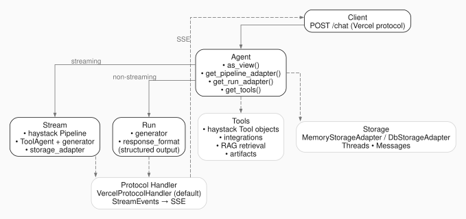
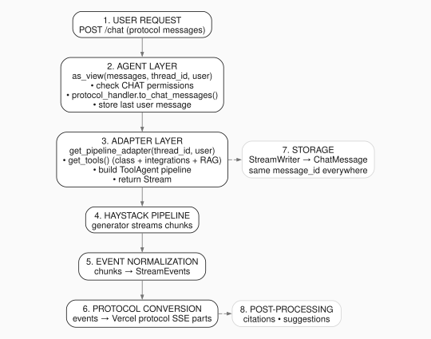

The core abstractions, how a request flows through the system, and the design patterns behind them.



## Components

| Component | Responsibility | Page |
| --- | --- | --- |
| `Agent` | Coordinator; configures everything | [Agent](agent.md) |
| Registry + `AgentService` | Registration and stable-ID resolution | [Agent Registry](agent-registry.md) |
| `Stream` / `Run` | Haystack integration for chat and non-chat calls | [Stream and Run](stream-and-run.md) |
| Protocol handler | Wire format (Vercel, OpenAI, custom) | [Protocol Handler](protocol-handler.md) |
| Storage | Conversation persistence | [Storage](storage.md) |
| RAG | Knowledge retrieval as tools | [RAG](rag.md) |

Each component has a base class defining its interface; implementations live in subclasses. The internal message type is `ChatMessage` (`django_ai_sdk.common`): protocol-agnostic, so any handler can consume it.

## Request Data Flow

```
┌─────────────────────────────────────────────────────────────┐
│ 1. USER REQUEST                                             │
│    POST /api/chat with messages                             │
└──────────────────────┬──────────────────────────────────────┘
                       ▼
┌─────────────────────────────────────────────────────────────┐
│ 2. AGENT LAYER                                              │
│    agent.as_view(protocol_messages, thread_id, user)        │
│    ├─ Check CHAT permissions                                │
│    ├─ Convert protocol → ChatMessage                        │
│    ├─ Store last user message                               │
│    └─ Get pipeline adapter (Stream)                         │
└──────────────────────┬──────────────────────────────────────┘
                       ▼
┌─────────────────────────────────────────────────────────────┐
│ 3. STREAM LAYER                                             │
│    stream.stream(chat_messages)                             │
│    ├─ Generate UUID for message                             │
│    ├─ Run Haystack pipeline (ToolAgent)                     │
│    └─ Normalize chunks → StreamEvents                       │
└──────────────────────┬──────────────────────────────────────┘
                       ▼
┌─────────────────────────────────────────────────────────────┐
│ 4. HAYSTACK PIPELINE                                        │
│    Streaming chunks + tool calls                            │
└──────────────────────┬──────────────────────────────────────┘
                       ▼
┌─────────────────────────────────────────────────────────────┐
│ 5. PROTOCOL CONVERSION                                      │
│    Events → Vercel Protocol Parts (SSE)                     │
└──────────────────────┬──────────────────────────────────────┘
                       ▼
┌─────────────────────────────────────────────────────────────┐
│ 6. STORAGE                                                  │
│    StreamWriter → ChatMessage → Storage (same UUID)         │
└─────────────────────────────────────────────────────────────┘
```



## Design Patterns

| Pattern | Idea | Where |
| --- | --- | --- |
| Protocol-agnostic messages | Internal `ChatMessage` works with any frontend protocol | [Protocol Handler](protocol-handler.md) |
| Event-driven streaming | Normalized events decouple adapters from protocols | [Stream Events](stream-events.md) |
| Single ID source | `Stream.stream()` generates the UUID once; SSE, storage, and endpoints share it | [ID Generation](id-generation.md) |
| Storage adapter registry | Fastest-first detection of which backend holds a thread | [Custom Storage Adapters](storage-registry.md) |
| RAG provider caching | Expensive index building happens once, cached per agent + memory | [RAG](rag.md) |

Next: [Agent](agent.md), the coordinator class.
