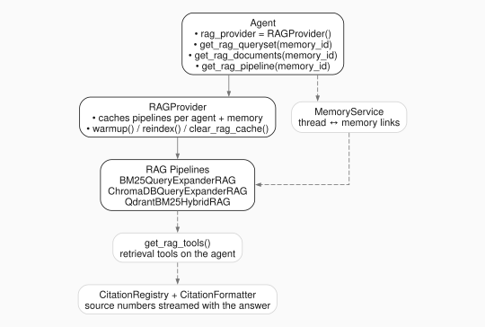

How RAG works in the SDK: the provider lifecycle, and how agents get retrieval as tools.

:::note
The [RAG Variants](rag-variants.md) page covers pipeline variants, config and the document model.
:::



## What is RAG?

Retrieval-Augmented Generation gives the model documents to answer from:

1. The user asks a question.
2. The agent retrieves relevant documents from a memory.
3. The documents pass back to the model as retrieved context.
4. The model responds and cites numbered sources.

## Enabling RAG on an agent

:::steps
1. **Set the provider.** Set `rag_provider = RAGProvider()` on the agent.
2. **Return the documents.** Override `get_rag_queryset()`, `get_rag_documents()` or both to select what gets indexed.
3. **Return a pipeline.** Implement `get_rag_pipeline()`, or one of the named variants, to return a RAG pipeline.
4. **Link memories to threads.** `get_rag_tools()` builds one retrieval tool per active memory.
:::

```python
from django_ai_sdk.memories.models import Entry
from django_ai_sdk.rags import BM25QueryExpanderRAG, BM25QueryExpanderRAGConfig
from django_ai_sdk.rags.provider import RAGProvider

class MyAgent(Agent):
    rag_provider = RAGProvider()

    async def get_rag_queryset(self, memory_id=None):
        if memory_id:
            return Entry.objects.filter(memory_id=memory_id)
        return Entry.objects.all()

    async def get_rag_pipeline(self, memory_id=None):
        documents = await self.get_rag_documents(memory_id)
        if not documents:
            return None
        return BM25QueryExpanderRAG(
            documents=documents,
            config=BM25QueryExpanderRAGConfig(top_k=5, n_expansions=4),
        )
```

Wire the retrieval tools into the `ToolAgent` inside `get_pipeline_adapter()`:

```python
async def get_pipeline_adapter(self, thread_id=None, user=None):
    generator = self.get_llm()
    citation_registry = self.get_citation_registry()

    rag_tools = await self.get_rag_tools(
        thread_id=thread_id,
        citation_registry=citation_registry,
        citation_formatter=self.get_citation_formatter(),
        user=user,
    )
    tool_agent = ToolAgent(
        config=ToolAgentConfig(
            model=self.get_model(),
            system_prompt=self.get_system_prompt(),
            tools=[*await self.get_tools(thread_id=thread_id, user=user), *rag_tools],
        ),
        generator=generator,
    )
    return Stream(
        pipeline=tool_agent.pipeline(),
        generator=generator,
        storage_adapter=await self.get_storage_adapter(thread_id),
        citation_registry=citation_registry,
    )
```

## RAGProvider

`RAGProvider` manages the RAG lifecycle. It warms up instances by building their indexes, keeps them in an LRU cache (`_MAX_CACHE_SIZE = 100`), and converts pipelines to tools.

| Method | Purpose |
| --- | --- |
| `warmup(agent, memory_id, force_rebuild=False)` | Build indexes via `get_or_create`, then cache the RAG instance |
| `get_rag_instance(agent, memory_id)` | Return the cached RAG, creating + warming it if absent |
| `get_cached_rag_instance(agent, memory_id)` | Return the cached RAG without touching the store (safe when a second connection would conflict, e.g. Qdrant's exclusive local lock) |
| `get_tool(agent, memory_id, *, spec, citation_registry, citation_formatter)` | Build a `ComponentTool` with optional citation wiring |
| `build_tool(rag_instance, *, spec=None)` | Wrap a RAG instance as a `ComponentTool` (`get_tool(spec)` with a spec, else `as_tool()`) |
| `add_documents(agent, memory_id, documents)` | Incrementally add documents to an existing index |
| `remove_documents(agent, memory_id, document_ids)` | Incrementally remove documents from an existing index |
| `reindex(agent, memory_id, force_rebuild=False)` | Drop the cache entry and rebuild (returns the new instance) |
| `clear_cache()` | Drop all cached RAG instances |

:::caution
A per-key `asyncio.Lock` serializes warmups per cache key, so concurrent requests for the same memory don't build twice. This matters for backends like Qdrant that hold an exclusive file lock during warmup. A warm cache returns without acquiring any lock.
:::

## Integration through tool calling

The agent gets RAG as one retrieval tool per memory, and the model decides when to call it. The SDK never injects context on its own. Each memory linked to the thread produces one tool, named after its `ToolSpec`:

```python
spec = await memory.get_tool_spec()  # -> ToolSpec(name="search_documents", ...)
```

Tool names are namespaced per memory, so unrelated memories don't collide. If two memories produce the same name, the SDK suffixes the later one with a short memory-ID hash and logs a warning. It skips memories with zero documents, also with a warning. Retrieval results stream back as numbered `SourceEvent`s.

## Citations

The model sees retrieved sources as numbered citations, and the frontend receives them in the stream:

- `get_citation_registry()` returns a new `CitationRegistry` for each turn, so indices reset between turns.
- `get_citation_formatter()` and `citation_formatter_class` decide how sources render for the model. `DefaultCitationFormatter` numbers sources so the model can reference them inline.
- `Stream` emits a `SourceEvent(index, title, content, source_id, ...)` per source after a retrieval tool runs, in cumulative-index order.
- Protocol handlers translate these into the frontend's citation format. Vercel `source-document` parts carry the citation index in `providerMetadata`.

Pass the same registry and formatter to `get_rag_tools()` and to the `Stream`, so the numbers the model cites match the sources the frontend gets.

## Lifecycle

| Action | Where | Effect |
| --- | --- | --- |
| Warm up | `Agent.warmup(agent, memory_id)` (classmethod) | Pre-builds and caches pipelines; no-op without a provider |
| Auto warm up | `warmup_on_init = True` | Schedules `rag_provider.warmup()` on instantiation |
| Reindex | `Agent.reindex(agent, memory_id, force_rebuild)` | Drops the cache entry and rebuilds; persistent backends (Qdrant) delete and recreate |
| Clear cache | `Agent.clear_rag_cache(agent)` | Drops all cached instances |
| CLI | `python manage.py warmup_rag --agent <name>` | Warms up from the command line ([CLI](cli.md)) |

```python
await MyAgent.warmup(agent, memory_id="mem-1")                 # build once
await MyAgent.reindex(agent, memory_id="mem-1")                # rebuild
MyAgent.clear_rag_cache(agent)                                 # drop cache
```

## Best practices

| Practice | Why |
| --- | --- |
| Route through the provider (`get_rag_instance`) | Avoids rebuilding the index on every call |
| Use `get_cached_rag_instance()` with Qdrant | Its local file lock is exclusive, so reuse the warmed instance |
| Return `None` from `get_rag_pipeline()` with no documents | Provider caches `None`; `get_rag_tools()` skips the memory cleanly |
| Set `top_k` to match your context budget | `1` risks missing context; `50` fills the context window. Start at `5` |
| Reindex after document changes | Or use incremental `add_documents()` / `remove_documents()` |

Next: [Storage](storage.md), where conversations persist.
