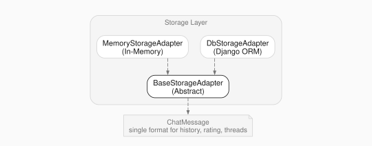

How conversations persist. A conversation is a thread of messages, and all adapters store the same `ChatMessage` format.



:::note
For thread operations in views, use [ThreadService](thread-service.md). To build a custom backend, see [Custom Storage Adapters](storage-registry.md).
:::

## Available adapters

| Adapter | Persistence | Speed | Best for |
| --- | --- | --- | --- |
| `MemoryStorageAdapter` | In-memory | Fastest | Testing, development |
| `DbStorageAdapter` | Django ORM | Slower | Production, long-term |

```python
from django_ai_sdk.storage.db import DbStorageAdapter

class MyAgent(Agent):
    storage_adapter = DbStorageAdapter  # or MemoryStorageAdapter
```

Both use the same format and interface, so switching is a one-line change.

## The ChatMessage format

`ChatMessage` (in `django_ai_sdk.common`) is the message format every adapter persists:

| Field | Type | Description |
| --- | --- | --- |
| `role` | `"system" \| "user" \| "assistant"` | Message role |
| `content` | `str` | Message text |
| `reasoning` | `str \| None` | Model reasoning (when supported) |
| `id` | `str` | Message UUID |
| `tool_calls` | `list[dict]` | Tool calls with `id`, `name`, `arguments`, `result` |
| `sources` | `list[dict]` | RAG citation references (`index`, `title`, `source_id`, `memory_id`, `page_number`) |
| `model` | `str` | Model identifier |
| `finish_reason` | `str` | `stop`, `error`, `cancelled`, ... |
| `errors` | `list[str]` | Error messages (when the stream failed) |
| `metadata` | `dict` | Arbitrary metadata (e.g. `feedbacks`) |
| `created_at` | `str` | ISO timestamp |
| `processing_time_ms` | `int` | Total processing time |
| `started_at` / `completed_at` | `float` | Unix timestamps |

It has these helpers: `.text` (alias of `content`), `.duration`, `.has_tools`, `.has_errors` and `.finalize(finish_reason)`.

## Adapter API

Every adapter implements `BaseStorageAdapter` (`django_ai_sdk.storage.base`).

### Class methods: thread management

```python
thread_id = await DbStorageAdapter.create_thread(
    title="My Conversation",
    metadata={"agent_id": "..."},   # agent_id should be included
    user=request.user,              # optional owner
)

thread = await DbStorageAdapter.get_thread(thread_id)      # -> ThreadInfo | None
threads = await DbStorageAdapter.list_threads(user=None, limit=100, offset=0)
await DbStorageAdapter.update_thread(thread_id, title="New title")
await DbStorageAdapter.delete_thread(thread_id)            # -> bool
```

`list_threads` paginates with `limit` and `offset`. By default (`limit=None`) it returns everything.

`ThreadInfo` has `id`, `title`, `agent_id`, `model`, `user_id`, `created_at`, `updated_at`, `metadata`, `message_count`, `file_memory_id`.

### Instance methods: thread-specific operations

```python
storage = DbStorageAdapter(thread_id)   # bound to a thread

messages = await storage.get_messages()                     # list[ChatMessage]
message_id = await storage.store_chat_message(chat_message) # -> str
await storage.rate_message(message_id, rating=1, feedback="great", user=request.user)
await storage.delete_message(message_id)                    # soft delete
await storage.restore_message(message_id)                   # undo delete
```

### `storage_callback`

`StreamWriter` calls the async `storage_callback(chat_message)` to persist streamed replies. `Agent.get_storage_adapter(thread_id)` queries all registered adapters to find the one that holds a thread. If none does, it falls back to the agent's configured `storage_adapter`.

## How streaming persists messages

:::steps
1. `Stream.stream()` generates the `message_id` and creates a `StreamWriter` bound to it.
2. As chunks stream, `stream_writer.add_chunk(chunk)` accumulates text, reasoning, tool calls, and errors.
3. `Stream.get_final_message()` attaches citation sources, then calls `stream_writer.finalize("stop")`.
4. `finalize()` calls `storage_adapter.storage_callback(message)` to persist it.
:::

Failed streams persist with `finish_reason="error"`, cancelled ones with `"cancelled"`. SSE, storage and API endpoints all use the same `message_id`. See [ID Generation](id-generation.md).

## Examples

### Create a thread and store messages

```python
from django_ai_sdk.common import ChatMessage
from django_ai_sdk.storage.services import ThreadService

thread_id = await ThreadService.create_thread(agent_id, title="Pirate Conversation", user=request.user)
storage = await ThreadService.storage_for_thread(thread_id, user=request.user)

user_id = await storage.store_chat_message(ChatMessage(role="user", content="Tell me a joke"))
assistant_id = await storage.store_chat_message(ChatMessage(role="assistant", content="Why did the pirate go to the Apple store?"))

for msg in await storage.get_messages():
    print(f"{msg.role}: {msg.content}")
```

### Portable history

```python
for msg in await memory_storage.get_messages():
    await db_storage.store_chat_message(msg)
```

Next: [ThreadService](thread-service.md), permission-checked thread operations.
